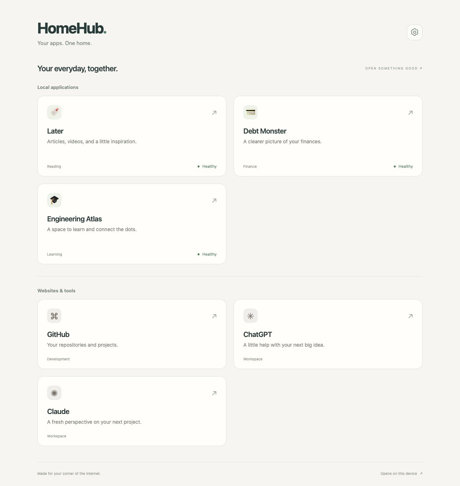
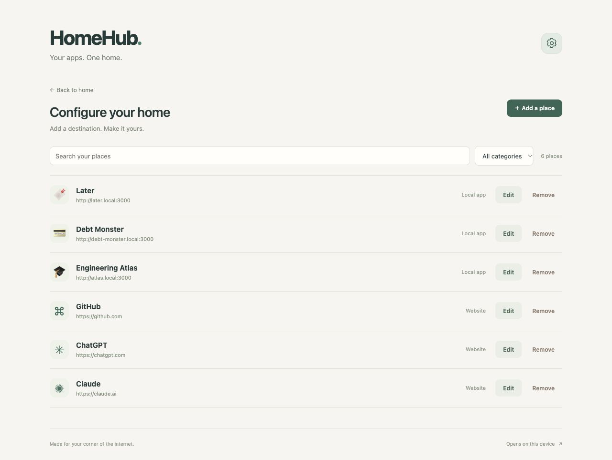

# HomeHub

**Your apps. One home.** A lightweight, responsive dashboard for a trusted home LAN. Add, edit, categorize, search, and remove local apps and website shortcuts. Each opens in a new browser tab **on the device viewing HomeHub**. No server-side browser launching, dependencies, accounts, or process controls.

## Screenshots

Screenshots use illustrative entries and demo health checks, not a live collection of configured apps. HomeHub starts empty so you can add your own destinations.

**Your home:** local applications and favorite websites, with health indicators for local apps.



**Configure:** manage destinations in one place, with search, categories, and edit/remove controls.



## Run on Mac or Linux

Requires Python 3.10+ (check `python3 --version`). From this repository:

```sh
./start.sh
```

On Mac you can also double-click `Start.command`. Visit `http://localhost:8080` on the server, or `http://<server-LAN-IP>:8080` / `http://raspberrypi.local:8080` from another device. Allow incoming connections on your private network if the firewall prompts. Stop with Ctrl-C. Optional settings: `HOMEHUB_HOST`, `HOMEHUB_PORT`, `HOMEHUB_DATA` (default `data/entries.json`). For example `HOMEHUB_PORT=8090 ./start.sh`. There is no build step.

## Add your places

The home screen separates local applications from websites and tools. The Configure screen contains search, category filters, and all add/edit/remove controls; use Back to home when you are done.

Open **Configure** using the gear in the top corner, then choose **Add a place** and enter a name, description, emoji/text icon or uploaded PNG, category, and HTTP(S) destination. Select **Local app** for an optional health endpoint, or **Website** for an unmonitored shortcut. Empty categories become General. Data persists in an atomically replaced JSON file; back it up while the server is stopped. Run only one HomeHub process against a data file. Up to 100 entries are supported.

### Two different network perspectives

- **Destination URL:** opened by the visitor's browser. Use `http://192.168.1.50:8096` or `http://media-server.local:8096`, reachable from every viewing device. Never use `localhost`, `127.0.0.1`, or `0.0.0.0`: those refer to the visitor's own machine or an invalid destination. HomeHub rejects these addresses. The destination service must listen on its LAN interface and permit LAN traffic. `.local` resolution depends on your devices/network; use a reserved LAN IP if needed.
- **Health endpoint:** fetched by the HomeHub server. It can use server loopback if the service runs alongside HomeHub, or a private LAN address. A healthy check means the **server** can reach that endpoint, not that every client can reach the destination. Configure a suitable unauthenticated endpoint; no credentials are stored.

Local apps show **Unknown** when no endpoint is configured or the first check is pending, **Healthy** for HTTP 200–399, and **Unreachable** for HTTP errors, network/TLS failures, or blocked targets. Checks run in four background workers with a three-second socket timeout, cached for 30 seconds while pages poll. Redirects count as a response and are never followed. Websites show Website and are never checked.

Health targets are resolved on every probe and must resolve entirely to RFC1918 IPv4, IPv6 ULA, or loopback. Public, link-local (including cloud metadata), multicast, and unspecified addresses are blocked. The connection pins a validated IP to prevent DNS rebinding, with normal HTTPS certificate/hostname verification. Health checks are read-only GET requests, but choose endpoints without side effects.

## Raspberry Pi autostart (Raspberry Pi OS / systemd)

Install Python and Git, clone this repository to `/opt/home-hub`, and create a dedicated service user:

```sh
sudo apt update
sudo apt install -y python3 git
sudo git clone https://github.com/archieLa/home-hub.git /opt/home-hub
sudo useradd --system --user-group --home-dir /nonexistent --shell /usr/sbin/nologin homehub
sudo cp /opt/home-hub/deploy/homehub.service /etc/systemd/system/
sudo systemctl daemon-reload
sudo systemctl enable --now homehub
sudo systemctl status homehub
```

Open `http://raspberrypi.local:8080` or the Pi's LAN IP on your phone/Mac/tablet. Logs: `sudo journalctl -u homehub -f`. Data: `/var/lib/homehub/entries.json`. Updates: `sudo git -C /opt/home-hub pull --ff-only && sudo systemctl restart homehub`. To change settings, use `sudo systemctl edit homehub` with a `[Service]` section and `Environment=HOMEHUB_PORT=8090`, then reload/restart. If migrating existing data, stop the service, copy the JSON to `/var/lib/homehub/entries.json`, and assign ownership to `homehub:homehub` before starting.

## Trust and security

HomeHub intentionally has no authentication: anyone who can reach it can view and edit shortcuts and request restricted health checks. Use only a trusted LAN; do not expose or port-forward it to the internet. Limit port 8080 with your firewall if guests share the network. HTTP is plain text. No reverse proxy is required. Requests use same-origin protections, bounded bodies and entry counts, HTTP(S)-only URL validation, safe DOM text rendering, local assets, a restrictive content security policy, and private-by-default data file permissions. Local configuration files and administrators are trusted.

## Verification

```sh
python3 -m unittest discover -s tests -v
python3 -m py_compile server.py
node --check static/app.js  # optional, if Node is installed
```

The tests exercise API persistence/CRUD, validation, request protections, health responses, and health-target restrictions using local test servers. No third-party Python packages are needed.

Image icons: upload a PNG in the add/edit form (up to 128 KB, at most 1024 × 1024 pixels). A preview appears before saving. Remove image to return to the emoji/text icon. Images are embedded in the configuration JSON, so backups include them and no external image hosting is required.
